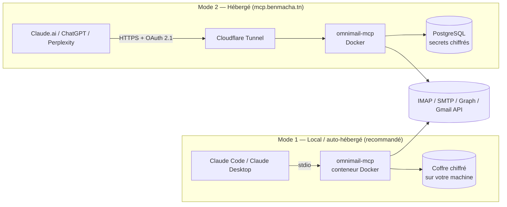

# omnimail-mcp

> Un serveur **MCP** (Model Context Protocol) open source qui relie **toutes vos boîtes mail** — iCloud, Gmail, Outlook, Yahoo, Proton, Infomaniak, et n'importe quel serveur IMAP — à votre assistant IA : **Claude Code, Claude (web / desktop), ChatGPT, Perplexity**.
>
> Lire, chercher dans tous les comptes à la fois, résumer, préparer des réponses, trier, nettoyer, détecter le spam, archiver — en gardant le contrôle de vos données, conformément au **RGPD** et aux recommandations de la **CNIL**.

**Statut : conception (phase 0).** Le code n'existe pas encore ; ce dépôt contient le plan, l'architecture et le cadre de conformité. Voir [docs/PLAN.md](docs/PLAN.md).

---

## Sommaire

- [Pourquoi](#pourquoi)
- [Ce que l'outil fera](#ce-que-loutil-fera)
- [Deux modes d'utilisation](#deux-modes-dutilisation)
- [Fournisseurs pris en charge](#fournisseurs-pris-en-charge)
- [Clients IA compatibles](#clients-ia-compatibles)
- [Démarrage rapide (cible)](#démarrage-rapide-cible)
- [Sécurité et vie privée](#sécurité-et-vie-privée)
- [Documentation](#documentation)
- [Licence](#licence)

---

## Pourquoi

Les assistants IA savent lire du texte, mais vos mails sont éparpillés entre plusieurs fournisseurs, chacun avec son mode de connexion (mot de passe d'application, OAuth, pont local pour Proton…). `omnimail-mcp` offre **une seule interface** pour tous vos comptes, exposée en MCP, le standard ouvert que comprennent Claude, ChatGPT et les autres.

## Ce que l'outil fera

| Domaine | Exemples d'outils MCP |
|---|---|
| Comptes | `accounts_list`, `account_status` (santé de chaque connexion) |
| Lecture | `mail_search` (tous comptes), `mail_get`, `thread_get`, `folders_list`, `attachment_get` |
| Réponse | `draft_create`, `draft_reply` (brouillon), `mail_send` (confirmation obligatoire) |
| Organisation | `mail_move`, `mail_flag`, `mail_mark_read`, `label_apply`, `folder_create` |
| Nettoyage | `cleanup_plan` (simulation), `cleanup_apply`, `newsletters_list`, `unsubscribe` (RFC 8058) |
| Spam & sécurité | `spam_score` (SPF / DKIM / DMARC + heuristiques + Rspamd optionnel), `phishing_check` |
| Archivage | `archive_export` (EML / MBOX), `archive_schedule`, alertes en cas de déconnexion |

Toute action destructrice passe par un **plan en simulation (dry-run)** que l'utilisateur valide avant exécution.

Des **prompts MCP / skills** prêts à l'emploi : « tri du matin », « grand ménage newsletters », « détection d'arnaques », « résumé de la semaine », « réponses en attente ».

## Deux modes d'utilisation



- **Local** : vous lancez le conteneur chez vous, vos identifiants ne quittent jamais votre machine. Vous êtes votre propre responsable de traitement.
- **Hébergé** : une URL publique pour les clients web (Claude.ai, ChatGPT) qui ne savent pas parler à un programme local. Connexion par compte + OAuth, secrets chiffrés, hébergement UE.

## Fournisseurs pris en charge

| Fournisseur | Méthode | Remarque |
|---|---|---|
| iCloud Mail | IMAP/SMTP + mot de passe d'application | Pas d'OAuth chez Apple |
| Gmail / Google Workspace | IMAP + mot de passe d'application, ou OAuth (XOAUTH2 / Gmail API) | OAuth public = audit de sécurité Google |
| Outlook.com / Microsoft 365 | OAuth 2.0 (Microsoft Graph ou IMAP XOAUTH2) | L'authentification par mot de passe IMAP n'est plus acceptée |
| Yahoo Mail / AOL | IMAP/SMTP + mot de passe d'application | |
| Proton Mail | Proton Mail Bridge (conteneur dédié) | Nécessite un abonnement payant Proton |
| Infomaniak | IMAP/SMTP | `mail.infomaniak.com` |
| Autres (OVH, Zoho, GMX, Fastmail, serveur perso…) | IMAP/SMTP générique (JMAP plus tard) | |

Détails : [docs/FOURNISSEURS.md](docs/FOURNISSEURS.md).

## Clients IA compatibles

| Client | Mode | Comment |
|---|---|---|
| Claude Code | local (stdio) ou distant | `claude mcp add` ou plugin via la marketplace de ce dépôt |
| Claude Desktop | local | extension `.mcpb` ou config JSON |
| Claude.ai (web / mobile) | hébergé | Paramètres → Connecteurs → connecteur personnalisé |
| ChatGPT | hébergé | Mode développeur → connecteur / app MCP |
| Perplexity | local (app Mac) / distant selon offre | à vérifier lors des tutoriels |

Instructions pas à pas (avec captures à venir) : [docs/CLIENTS.md](docs/CLIENTS.md).

## Démarrage rapide (cible)

> Ces commandes décrivent l'objectif de la phase 1 ; elles ne fonctionnent pas encore.

```bash
# Claude Code — mode local, via Docker
claude mcp add omnimail -- docker run -i --rm \
  -v omnimail-data:/data ghcr.io/benmacha/omnimail-mcp:latest

# Ajouter un compte (assistant interactif, le mot de passe n'est jamais affiché)
docker run -it --rm -v omnimail-data:/data ghcr.io/benmacha/omnimail-mcp:latest accounts add
```

```bash
# Claude Code — via la marketplace de plugins de ce dépôt
/plugin marketplace add BenMacha/omnimail-mcp
/plugin install omnimail@omnimail
```

## Sécurité et vie privée

- **Jamais votre mot de passe principal** : mots de passe d'application ou OAuth uniquement.
- Secrets **chiffrés au repos** (coffre local chiffré / chiffrement par enveloppe côté hébergé).
- **Pas de copie des mails** côté serveur par défaut : lecture à la demande, cache optionnel et purgeable.
- Actions destructrices = **simulation + confirmation**, journal d'audit consultable.
- Protection contre l'**injection de prompt** contenue dans les mails (contenu marqué comme non fiable, envoi jamais automatique).
- Droit d'accès, d'export et d'effacement en un clic (mode hébergé).

Détails : [docs/CONFORMITE-RGPD.md](docs/CONFORMITE-RGPD.md) et [SECURITY.md](SECURITY.md).

## Documentation

| Document | Contenu |
|---|---|
| [docs/PLAN.md](docs/PLAN.md) | Plan, phases, faisabilité, décisions à prendre |
| [docs/ARCHITECTURE.md](docs/ARCHITECTURE.md) | Composants, diagramme de classes, scénarios (séquences), états |
| [docs/FOURNISSEURS.md](docs/FOURNISSEURS.md) | Connexion à chaque fournisseur |
| [docs/CLIENTS.md](docs/CLIENTS.md) | Installation dans Claude, ChatGPT, Perplexity ; marketplaces |
| [docs/CONFORMITE-RGPD.md](docs/CONFORMITE-RGPD.md) | RGPD, CNIL, stockage des identifiants |
| [docs/OUTILS-MCP.md](docs/OUTILS-MCP.md) | Catalogue des outils, prompts et ressources MCP |
| [docs/tutoriels/](docs/tutoriels/) | Tutoriels illustrés (captures générées dans Docker) |

## Licence

[AGPL-3.0](LICENSE) — libre d'utiliser, modifier et auto-héberger ; toute version modifiée proposée en service en ligne doit publier son code source.
