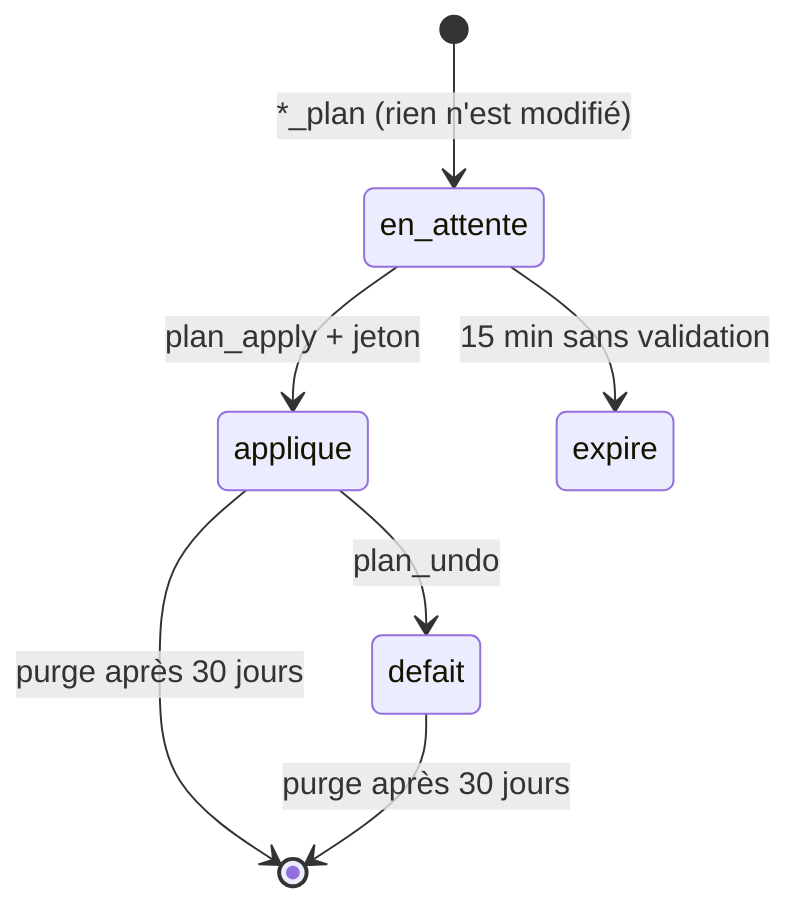

# Catalogue MCP : outils, prompts (skills), ressources

## Sommaire

- [Outils disponibles (0.1.0)](#outils-disponibles-010)
- [Envois récurrents et désabonnement](#envois-récurrents-et-désabonnement)
- [Classement en sous-dossiers et déclassement](#classement-en-sous-dossiers-et-déclassement)
- [Nettoyage](#nettoyage)
- [Plans : simulation, validation, annulation](#plans--simulation-validation-annulation)
- [Prompts / skills](#prompts--skills)
- [Réglages](#réglages)
- [Outils prévus](#outils-prévus)

Légende : 👁 lecture seule · ✏️ modification réversible · ⚠️ sensible (plan + confirmation, ou désactivé par défaut).

## Outils disponibles (0.1.0)

| Outil | Type | Description |
|---|---|---|
| `accounts_list` | 👁 | Comptes configurés, sans secret |
| `account_status` | 👁 | Test de connexion de chaque compte, cause de l'échec le cas échéant |
| `folders_list` | 👁 | Dossiers avec nombre de messages et de non lus |
| `mail_search` | 👁 | Recherche en parallèle dans plusieurs comptes : texte, expéditeur, objet, dates, non lus, taille, dossier (`inbox`, `all`, chemin), requête Gmail native |
| `mail_get` | 👁 | Contenu d'un mail (texte ; HTML converti), pièces jointes listées |
| `attachment_get` | 👁 | Pièce jointe (texte ou binaire, 5 Mo maximum) |
| `recurring_senders_list` | 👁 | Expéditeurs récurrents : volume, mails/semaine, taux de lecture, méthode de désabonnement |
| `unsubscribe_plan` | 👁 | Prépare désabonnements + rangement des anciens mails |
| `classify_plan` | 👁 | Prépare un classement en sous-dossiers |
| `cleanup_plan` | 👁 | Prépare un nettoyage (archive ou corbeille) |
| `plan_apply` | ⚠️ | Exécute un plan validé (jeton de confirmation obligatoire) |
| `plan_undo` | ✏️ | Défait un plan : remet les mails en place, supprime les dossiers créés vides |
| `plans_list` | 👁 | Plans des 30 derniers jours |
| `mail_move` | ✏️ | Déplace des mails vers un dossier (créé au besoin) |
| `mail_mark` | ✏️ | Lu / non lu, important |
| `spam_check` | 👁 | Score de spam / hameçonnage et raisons |
| `draft_create` | ✏️ | Brouillon |
| `draft_reply` | ✏️ | Brouillon de réponse dans le même compte, en-têtes de fil corrects |
| `mail_send` | ⚠️ | Envoie un brouillon ; refusé tant que `sendEnabled` est faux |
| `audit_log` | 👁 | Journal des actions |
| `settings_get` | 👁 | Réglages actifs |

Tout contenu de mail renvoyé par un outil est encadré par `<<<CONTENU_MAIL_NON_FIABLE>>>` et précédé d'un avertissement destiné à l'IA.

## Envois récurrents et désabonnement

`recurring_senders_list` analyse les mails d'une période (90 jours par défaut) et les regroupe par **List-Id** (identifiant de liste de diffusion) ou, à défaut, par **adresse d'expéditeur**. Un groupe est retenu s'il compte au moins `minCount` mails (3 par défaut), ou au moins 2 s'il porte des en-têtes de liste.

Pour chaque expéditeur : nombre de mails, non lus, **taux de lecture**, mails par semaine, comptes concernés, exemples d'objets, et la **méthode de désabonnement** :

| Méthode | Origine | Ce que fait `plan_apply` |
|---|---|---|
| `one-click` | `List-Unsubscribe` https + `List-Unsubscribe-Post: List-Unsubscribe=One-Click` (RFC 8058) | POST `List-Unsubscribe=One-Click` vers le lien, sans cookie ni identifiant ; adresses internes refusées |
| `mailto` | `List-Unsubscribe: <mailto:…>` | envoie le mail de désabonnement depuis le compte concerné |
| `lien` | lien web sans one-click | **n'ouvre pas le lien** (une page peut demander une action ou pister) : il est rendu à l'utilisateur |
| `aucune` | pas d'en-tête | signalé ; proposer une règle de classement ou de nettoyage |

`unsubscribe_plan` ajoute, au choix (`thenMove`), le rangement des anciens mails : `rien`, `archive`, `corbeille`, ou `dossier` (`Classement/Newsletters/<expéditeur>`).

## Classement en sous-dossiers et déclassement

`classify_plan` range un dossier (INBOX par défaut) sous la racine `Classement/` :

- **mode `categorie`** : `Classement/Factures`, `Classement/Banque`, `Classement/Commandes`…
- **mode `expediteur`** : `Classement/Newsletters/Shop News`, `Classement/Commandes/Amazon`…
- **règles personnalisées** (prioritaires) : `{ "from": "durand.fr", "folder": "Pro/Clients/Durand" }`, `{ "subject": "devis", "folder": "Pro/Devis" }`, `{ "listId": "github", "folder": "Dev/GitHub" }`.

Catégories, par ordre de priorité : **Sécurité** (codes, alertes de connexion), **Factures**, **Banque**, **Administratif** (impots.gouv, ameli, CAF…), **Voyages**, **Commandes** (achats, colis), **Réseaux sociaux**, **Newsletters** (en-têtes de liste), **Notifications** (envois automatiques, no-reply). Les mails personnels ne sont pas déplacés.

Filtres : `days`, `olderThanDays`, `onlyRead`, `categories`. Les dossiers manquants sont créés avec le séparateur du serveur (`/` ou `.`).

**Déclasser** : `plan_undo { planId }` remet chaque mail dans son dossier d'origine (via la correspondance d'UID renvoyée par le serveur, ou à défaut le Message-ID), puis supprime les dossiers que le plan avait créés s'ils sont vides.

## Nettoyage

`cleanup_plan` vise un dossier et des mails plus anciens que `olderThanDays` (90 par défaut), lus uniquement par défaut, selon au moins un critère : `categories`, `senders` (adresse, domaine ou clé de liste), `largerThanKb`. Action : `archive` (dossier Archive du serveur, créé s'il n'existe pas) ou `corbeille`. **Jamais de suppression définitive.**

## Plans : simulation, validation, annulation

- Le plan est présenté à l'utilisateur (répartition, principaux expéditeurs, exemples).
- `plan_apply` exige le `confirmToken` du plan ; exclusions possibles (`excludeRefs`, `excludeSenders`).
- Plafond configurable : 5 000 mails par plan.
- Les plans ne contiennent que des références (compte, dossier, UID) et des Message-ID : aucun contenu.

## Prompts / skills

Exposés comme **prompts MCP** (tous clients) et comme **skills** du plugin Claude Code (`plugin/skills/`).

| Nom | Ce que ça fait |
|---|---|
| `tri-du-matin` | Non lus des dernières 24 h, tous comptes : urgent / à répondre / information / bruit |
| `menage-newsletters` | Envois récurrents → choix des désabonnements → plan → validation |
| `classement-dossiers` | Classement en sous-dossiers, règles personnalisées, déclassement |
| `grand-nettoyage` | Archivage des vieilles newsletters, notifications, gros mails |
| `detecteur-arnaques` | `spam_check` sur les mails récents, explications simples |
| `reponses-en-attente` | Mails de personnes restés sans réponse, brouillons proposés (prompt MCP) |

## Réglages

`omnimail settings set <clé> <valeur>` ou `settings.json` dans le dossier de données.

| Clé | Défaut | Rôle |
|---|---|---|
| `sendEnabled` | `false` | Autorise `mail_send` (aussi `OMNIMAIL_SEND_ENABLED=true`) |
| `maxActionsPerPlan` | `5000` | Taille maximale d'un plan |
| `planTtlMinutes` | `15` | Durée de validité d'un plan avant confirmation |
| `searchLimitPerAccount` | `50` | Résultats par compte et par dossier |
| `classifyRoot` | `Classement` | Dossier racine du classement |

## Outils prévus

| Outil | Phase |
|---|---|
| `thread_get` (conversation complète) | 4 |
| Outlook / Microsoft 365 (Graph, OAuth), Gmail OAuth | 4 |
| `archive_export`, `archive_schedule` (EML / MBOX, incrémental) | 6 |
| Surveillance de connexion et `notifications_configure` (e-mail, ntfy, webhook, Telegram) | 6 |
| `rules_list` / `rule_create` (règles enregistrées et planifiées) | 6 |
| `mailbox_stats`, détection de doublons entre comptes, rappels de relance | 6 |
