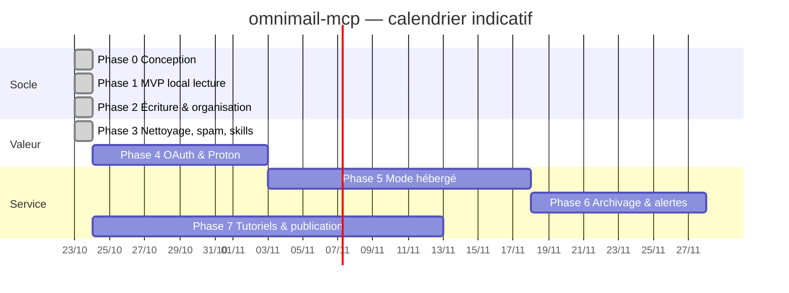
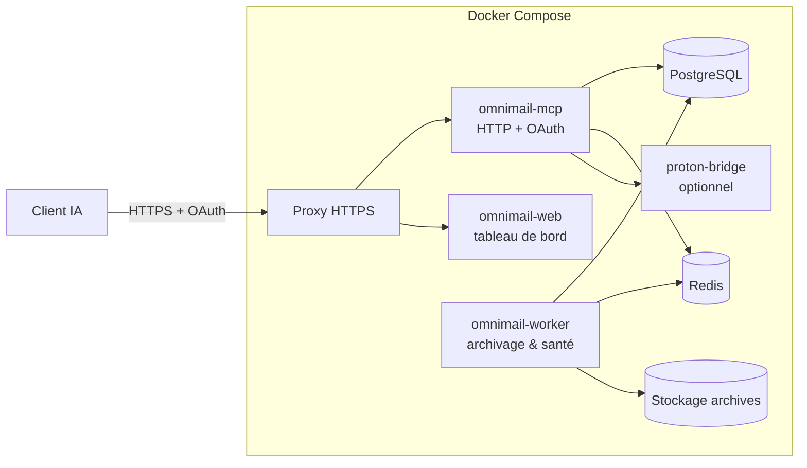

# Plan du projet omnimail-mcp

## Sommaire

- [1. Objectif](#1-objectif)
- [2. Faisabilité — verdict](#2-faisabilité--verdict)
- [3. Choix techniques](#3-choix-techniques)
- [4. Phases](#4-phases)
- [5. Calendrier indicatif](#5-calendrier-indicatif)
- [6. Stockage des identifiants : la décision](#6-stockage-des-identifiants--la-décision)
- [7. Hébergement](#7-hébergement)
- [8. Tutoriels et captures d'écran](#8-tutoriels-et-captures-décran)
- [9. Marketplaces et annuaires](#9-marketplaces-et-annuaires)
- [10. Risques](#10-risques)
- [11. Décisions à valider par Dali](#11-décisions-à-valider-par-dali)

---

## 1. Objectif

Une interface unique, pilotable par une IA, sur **plusieurs comptes mail de plusieurs fournisseurs** :
voir, chercher, résumer, répondre, réorganiser, nettoyer, détecter le spam, archiver — utilisable depuis
Claude Code, Claude (web/desktop), ChatGPT et Perplexity, en open source, déployée sous Docker, conforme RGPD/CNIL.

## 2. Faisabilité — verdict

**Faisable.** Toutes les briques existent et sont standard :

| Brique | État | Commentaire |
|---|---|---|
| MCP (stdio + Streamable HTTP, OAuth 2.1) | standard ouvert, SDK officiels | Pris en charge par Claude, ChatGPT, Perplexity (à des degrés divers) |
| IMAP/SMTP | universel | Couvre iCloud, Yahoo, Infomaniak, Gmail, serveurs génériques |
| Microsoft Graph / Gmail API | API officielles | Nécessaires pour Outlook (OAuth obligatoire) et utiles pour Gmail |
| Proton | Proton Mail Bridge en conteneur | Seule voie officielle ; abonnement payant requis |
| Spam | en-têtes `Authentication-Results`, Rspamd | Rspamd est open source et existe en image Docker |
| Captures de tutoriels | Playwright dans Docker | Automatisable pour notre propre interface ; les écrans des clients IA demandent une connexion manuelle |

**Points durs (pas bloquants, mais à connaître) :**

1. **Gmail OAuth en mode public** : les scopes Gmail « restreints » exigent la vérification Google + un audit de sécurité annuel (CASA), payant. → Phase 1 avec mots de passe d'application ; option « apportez votre propre client OAuth Google » ; vérification Google seulement si le service hébergé décolle.
2. **Microsoft** : enregistrement d'une application Entra ID (gratuit), vérification d'éditeur conseillée pour éviter l'avertissement « éditeur non vérifié ».
3. **Clients web (Claude.ai, ChatGPT)** : ils n'accèdent qu'à un serveur **distant** en HTTPS → il faut le mode hébergé.
4. **Injection de prompt** : un mail malveillant peut contenir des instructions pour l'IA. Il faut une défense dès la conception (voir [ARCHITECTURE.md](ARCHITECTURE.md#7-sécurité-face-à-linjection-de-prompt)).
5. **Responsabilité RGPD en mode hébergé** : on manipule de la correspondance privée → AIPD (analyse d'impact) quasi certainement nécessaire avant ouverture au public.

## 3. Choix techniques

| Sujet | Choix proposé | Pourquoi |
|---|---|---|
| Langage | **TypeScript (Node 22 LTS)** | SDK MCP officiel de référence, `imapflow` / `nodemailer` / `mailparser` très matures |
| Serveur MCP | `@modelcontextprotocol/sdk` | stdio (local) + Streamable HTTP (distant) |
| Auth du service hébergé | OAuth 2.1 (spec d'autorisation MCP), passkeys ou lien magique e-mail | Exigé par Claude.ai / ChatGPT pour les connecteurs authentifiés |
| Base | SQLite (local), PostgreSQL 17 (hébergé) | Même schéma via un ORM (Drizzle) |
| File de tâches | BullMQ + Redis (hébergé), planificateur interne (local) | Archivage planifié, surveillance de connexion |
| Recherche | Recherche côté serveur IMAP/API + index local optionnel SQLite FTS5 | Pas de copie des mails par défaut |
| Spam | Score maison (SPF/DKIM/DMARC, listes, heuristiques) + Rspamd optionnel | |
| Interface web | Petite app (tableau de bord comptes, consentements, journal, export RGPD) | Indispensable en mode hébergé |
| Notifications | e-mail, ntfy, webhook, Telegram | Alerte de déconnexion / échec d'archivage |
| Conteneurs | Docker Compose, images publiées sur GHCR | |
| Exposition | Proxy HTTPS devant le conteneur | Aucun port de l'application exposé directement |
| Captures | Playwright (Chromium) en conteneur | Profil Compose `docs` |
| CI | GitHub Actions : lint, tests, build image, scan (Trivy), SBOM | |

## 4. Phases

### Phase 0 — Conception (ce dépôt, maintenant)
README, plan, architecture, diagrammes, cadre RGPD. **Livré.**

### Phase 1 — MVP local (lecture) ✅ 0.1.0
- Serveur MCP stdio en Docker.
- Comptes IMAP : iCloud, Gmail (mot de passe d'app), Yahoo, Infomaniak, générique.
- Coffre local chiffré (clé maître dans le trousseau du système ou en secret Docker).
- Outils : `accounts_list`, `account_status`, `folders_list`, `mail_search` (multi-comptes), `mail_get`, `thread_get`, `attachment_get`.
- Commande `accounts add` interactive, `accounts remove` (efface les secrets).
- Tests : serveur IMAP de test (GreenMail/Dovecot en conteneur).
- Installation documentée pour Claude Code et Claude Desktop.

### Phase 2 — Écriture et organisation ✅ 0.1.0 (sauf thread_get)
- `draft_create`, `draft_reply`, `mail_send` (confirmation obligatoire, désactivable globalement).
- `mail_move`, `mail_flag`, `mail_mark_read`, `label_apply`, `folder_create`.
- Annotations MCP (`readOnlyHint`, `destructiveHint`) sur tous les outils.
- Journal d'audit local.

### Phase 3 — Envois récurrents, désabonnement, classement, nettoyage, spam, skills ✅ 0.1.0
- `cleanup_plan` / `plan_apply` (simulation → validation → exécution, annulable : déplacement en corbeille, jamais suppression définitive par défaut).
- `recurring_senders_list` : détection des envois récurrents (List-Id, expéditeur), fréquence, taux de lecture.
- `unsubscribe_plan` : désabonnement one-click (RFC 8058) ou mailto, liens web restitués à l'utilisateur, rangement des anciens mails.
- `classify_plan` : classement en sous-dossiers par catégorie, par expéditeur ou par règles ; `plan_undo` pour déclasser.
- `spam_score`, `phishing_check`, Rspamd optionnel.
- Prompts MCP / skills : tri du matin, ménage newsletters, arnaques, résumé hebdo, réponses en attente.
- Plugin Claude Code + marketplace dans ce dépôt.

### Phase 4 — Fournisseurs OAuth et Proton
- Outlook / Microsoft 365 via Microsoft Graph (OAuth, appareil ou navigateur).
- Gmail via OAuth (client fourni par l'utilisateur en local ; client du projet en hébergé).
- Proton via conteneur Proton Mail Bridge.

### Phase 5 — Mode hébergé (domaine de la marque)
- Transport Streamable HTTP + serveur d'autorisation OAuth 2.1 (enregistrement dynamique de client).
- Interface web : inscription, ajout de comptes, consentements, journal, export et suppression.
- PostgreSQL + chiffrement par enveloppe des secrets ; Redis + worker.
- Proxy HTTPS, pare-feu applicatif, limitation de débit.
- Documents RGPD publiés : politique de confidentialité, CGU, registre, AIPD, contrat de sous-traitance.
- Bêta sur invitation avant ouverture.

### Phase 6 — Archivage et surveillance
- `archive_schedule` : export incrémental EML/MBOX vers volume local, S3/R2 compatible, ou NAS.
- Surveillance de santé des comptes (connexion, jeton expiré, mot de passe révoqué, quota).
- Notifications de déconnexion et d'échec, rapport d'archivage.
- Rétention et purge configurables.

### Phase 7 — Tutoriels, captures, publication
- Captures automatiques de notre interface (Playwright dans Docker).
- Captures des écrans Claude / ChatGPT / Perplexity (session connectée par Dali, voir §8).
- Publication : registre MCP officiel, catalogue Docker MCP, annuaire Anthropic, ChatGPT apps.

## 5. Calendrier indicatif

## 6. Stockage des identifiants : la décision

Question posée : « login / mot de passe en base de données ou dans un fichier ? » Réponse : **ça dépend du mode, et dans les deux cas on ne stocke jamais de mot de passe principal en clair.**

| | Mode local | Mode hébergé |
|---|---|---|
| Qui détient les secrets | l'utilisateur, sur sa machine | le service |
| Où | fichier coffre `/data/vault.enc` (chiffré AES-256-GCM / libsodium) | PostgreSQL, colonne chiffrée |
| Clé | clé maître dans le trousseau OS, un secret Docker ou une phrase de passe | chiffrement par enveloppe : une clé par utilisateur (DEK) chiffrée par une clé maître (KEK) hors base (secret Docker, puis KMS/HSM) |
| Type de secret | mot de passe d'application ou jeton OAuth | jeton OAuth de préférence ; mot de passe d'application sinon |
| Fichier `.env` | **jamais** pour les comptes mail ; seulement la config non sensible | idem |
| Connexion au service lui-même | aucune (local) | compte omnimail (passkey ou lien magique), séparé des boîtes mail |
| Effacement | `accounts remove` | bouton « supprimer mon compte » → effacement immédiat des secrets, purge des sauvegardes sous 30 jours |

Pourquoi pas de chiffrement « zéro connaissance » côté hébergé ? Parce que l'archivage planifié et les alertes
doivent pouvoir se connecter **sans l'utilisateur**. On l'assume, on le documente, et on propose une option
« sans tâche de fond » où la clé est dérivée d'une phrase de passe que seul l'utilisateur connaît.

## 7. Hébergement

- Le service hébergé vivra sur le domaine de la marque (à choisir), par exemple `mcp.<domaine>` pour le point d'entrée MCP et `app.<domaine>` pour l'interface web.
- Hébergement physique **dans l'UE** recommandé.
- Sauvegardes PostgreSQL chiffrées, rotation 30 jours.

## 8. Tutoriels et captures d'écran

- Un service Compose `docs-screenshots` (image Playwright + Chromium) génère les captures de **notre** interface web et de l'installation en terminal, à chaque version, dans `docs/tutoriels/img/`.
- Pour Claude.ai, ChatGPT et Perplexity : ces sites demandent un compte connecté. Règle : **Dali se connecte lui-même** dans le navigateur du conteneur (via noVNC) ; le script ne fait ensuite que naviguer et capturer. Aucun mot de passe n'est tapé par l'outil, aucune session n'est conservée après la séance.
- Les captures sont floutées automatiquement sur les zones sensibles (adresses, objets de mails) avant commit.

## 9. Marketplaces et annuaires

| Canal | Ajoutable directement depuis GitHub ? | Ce qu'il faut |
|---|---|---|
| **Marketplace de plugins Claude Code** | **Oui** — ce dépôt servira de marketplace | Fichier `.claude-plugin/marketplace.json` + plugin ; l'utilisateur fait `/plugin marketplace add BenMacha/omnimail-mcp` |
| **Registre MCP officiel** (`registry.modelcontextprotocol.io`) | Oui, via l'outil `mcp-publisher` et un `server.json` | Preuve de propriété de l'espace de noms `io.github.benmacha/*` par connexion GitHub |
| **Catalogue Docker MCP** | Par pull request sur le dépôt `docker/mcp-registry` | Image publique, fichier de description |
| **Extension Claude Desktop (`.mcpb`)** | Fichier publié en *release* GitHub, installable en double-clic | Soumission à l'annuaire Anthropic possible ensuite |
| **Annuaire des connecteurs Claude.ai** | Non — formulaire de soumission Anthropic | Serveur distant stable, OAuth, politique de confidentialité |
| **ChatGPT (apps / connecteurs)** | Non — soumission via la plateforme OpenAI | Serveur distant, OAuth, vérification ; en attendant, ajout manuel en mode développeur |
| **Perplexity** | À vérifier au moment de la phase 7 | |

Les procédures exactes de soumission évoluent vite : elles seront revérifiées et capturées en phase 7.

## 10. Risques

| Risque | Impact | Parade |
|---|---|---|
| Injection de prompt via un mail | IA qui envoie / supprime à la place de l'utilisateur | Contenu marqué non fiable, actions sensibles avec confirmation, envoi désactivable, pas d'action déclenchée par le contenu d'un mail |
| Fuite des secrets | Accès aux boîtes mail | Mots de passe d'app révocables, chiffrement par enveloppe, pas de log des secrets, rotation de clés |
| Vérification Google / Microsoft | Délai, coût | Mots de passe d'app d'abord, client OAuth fourni par l'utilisateur |
| Changement d'API des clients IA | Tutoriels périmés | Captures régénérées automatiquement, versions datées |
| Responsabilité juridique (hébergé) | Sanction CNIL | AIPD avant ouverture, bêta fermée, documents RGPD, hébergement UE |
| Fournisseur qui bloque les connexions | Compte inaccessible | Surveillance de santé + notification |

## 11. Décisions à valider par Dali

1. Nom du projet : `omnimail-mcp` — OK ?
2. Licence : **AGPL-3.0** (proposée) ou MIT / Apache-2.0 ?
3. Langage : TypeScript (proposé) ou Python ?
4. Nom de domaine de la marque (voir recherche de nom) et sous-domaines du service hébergé ?
5. Machine d'hébergement du mode hébergé (sys1 OVH ? autre ?) et qui est responsable de traitement (Dali en nom propre, une société ?).
6. Ouverture du mode hébergé : bêta sur invitation d'abord ?
7. Ordre des fournisseurs : iCloud + Gmail + Infomaniak en premier ?
